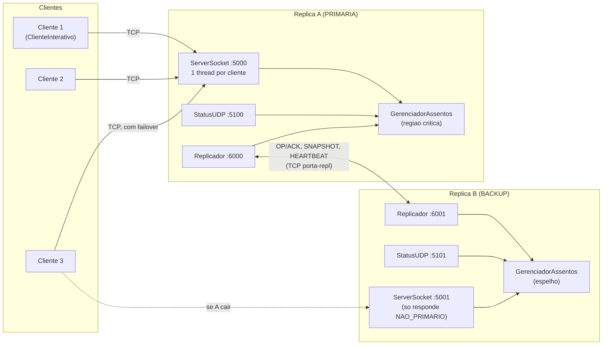
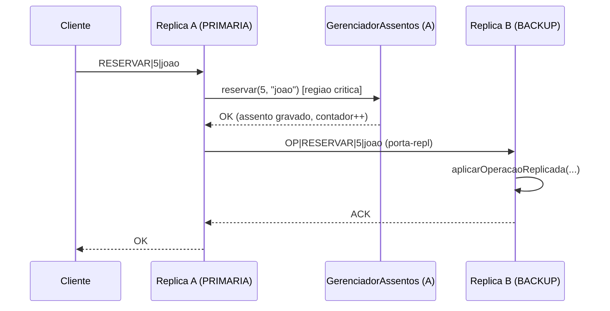
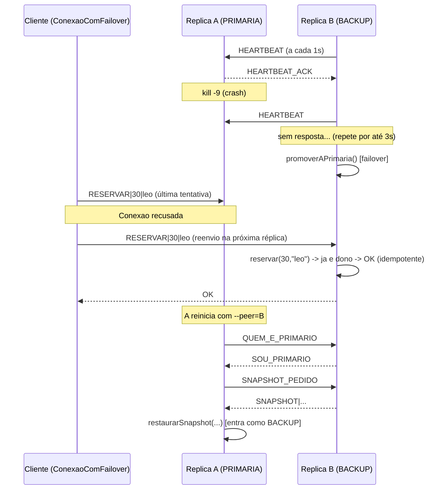

# Arquitetura

## Visão geral



## Versão ASCII (para quadro/terminal)

```
                         +-------------------+
        LISTAR/RESERVAR  |  Cliente (thread  |
      +----------------->|  do usuario, via  |
      |                  |  ConexaoComFailover|
      |                  +-------------------+
      |  TCP :5000                 | TCP :5001 (se A cair, NAO_PRIMARIO -> troca)
      v                            v
+-----------------------+   +-----------------------+
| REPLICA A - PRIMARIA  |   | REPLICA B - BACKUP    |
|                       |   |                       |
| ServerSocket :5000    |   | ServerSocket :5001    |
|   accept() em loop -->|   |   accept() em loop -->|
|   1 thread/cliente    |   |   1 thread/cliente    |
|        |              |   |        |              |
|        v              |   |        v              |
| GerenciadorAssentos   |   | GerenciadorAssentos   |
| (regiao critica:      |   | (espelho: aplica op   |
|  synchronized se      |   |  ja decidida pela     |
|  --sync=true)         |   |  primaria)            |
|        |              |   |        ^              |
|        v              |   |        |              |
| Replicador :6000  <---+---+--> Replicador :6001    |
|  - envia OP, espera   |   |  - recebe OP, responde |
|    ACK antes de       |   |    ACK                |
|    responder ao       |   |  - envia HEARTBEAT     |
|    cliente            |   |    a cada 1s           |
|                       |   |  - promove-se a        |
| StatusUDP :5100       |   |    PRIMARIA se nao     |
+-----------------------+   |    houver resposta     |
                             |    por >3s             |
                             | StatusUDP :5101        |
                             +-----------------------+
```

## Diagrama de sequência: RESERVAR com replicação síncrona



Só depois do `ACK` da backup a primária responde `OK` ao cliente
(replicação síncrona = consistência forte enquanto a backup estiver
disponível). Se a backup não responder dentro do timeout, a primária loga o
aviso e responde `OK` mesmo assim (modo degradado - ver Limitações).

## Diagrama de sequência: failover



## Threads em execução em cada réplica

| Thread | Responsabilidade |
|---|---|
| `main` | inicialização, `accept()` loop do `ServerSocket` |
| `ClienteHandler-<id>-<n>` (1 por cliente) | lê comandos de 1 cliente, chama `GerenciadorAssentos`, escreve a resposta |
| `StatusUDP` | loop `DatagramSocket.receive()`, responde `STATUS` |
| `Replicacao-Servidor-<id>` | `accept()` loop do canal de replicação |
| `Replicacao-Conexao-<id>` (1 por conexão recebida) | trata uma requisição de replicação (OP/SNAPSHOT/HEARTBEAT/QUEM_E_PRIMARIO) |
| `Heartbeat-<id>` (só quando o nó é BACKUP) | sonda a primária a cada 1s; promove o nó se ela não responder por >3s |

## Limitações conhecidas (documentadas com honestidade)

1. **Sem eleição por quórum.** A troca de papel é decidida sozinha pela
   backup (heartbeat) ou por descoberta simples na inicialização
   (`QUEM_E_PRIMARIO`). Não há um terceiro nó/árbitro para desempatar.
2. **Split-brain é possível em partição de rede.** Se a conexão entre A e B
   cair mas ambas continuarem de pé (e acessíveis a clientes diferentes), a
   backup vai se promover a primária **mesmo que a primária antiga ainda
   esteja viva** do outro lado da partição - as duas passariam a aceitar
   escritas de forma independente. Um sistema de produção precisaria de
   quórum (ex.: Raft/Paxos) para evitar isso; está fora do escopo desta
   atividade.
3. **Failover não é instantâneo.** Depende do heartbeat (1s) e do timeout
   (3s): no pior caso, uma reserva feita bem no instante da queda pode levar
   até ~4s para ser reencaminhada com sucesso pelo cliente.
4. **Réplica que cai no meio de uma operação replicada.** Se a primária
   cair depois de aplicar a operação localmente mas antes do `ACK` da
   backup chegar (ou antes de enviar o `OP`), essa operação especifica pode
   não ter sido replicada. O cliente, ao não receber resposta, trata isso
   como falha de conexão e reenvia o mesmo comando à próxima réplica; graças
   à idempotência do `RESERVAR`/`CANCELAR`, o reenvio não duplica nada -
   mas se a operação **nunca tinha chegado** à nova primária, ela é
   simplesmente refeita com sucesso (comportamento correto). O único caso
   não coberto é o cliente desistir antes de reenviar.
5. **Replicação em modo degradado.** Se a backup estiver fora do ar, a
   primária não bloqueia os clientes esperando por sempre: ela loga um
   aviso e responde `OK` mesmo sem replicar. Isso prioriza disponibilidade
   sobre consistência forte nesse cenário específico (uma escolha CAP
   deliberada e simples de explicar).
6. **Sem persistência em disco.** Todo o estado vive em memória; se as duas
   réplicas caírem ao mesmo tempo, o estado da sessão se perde.
